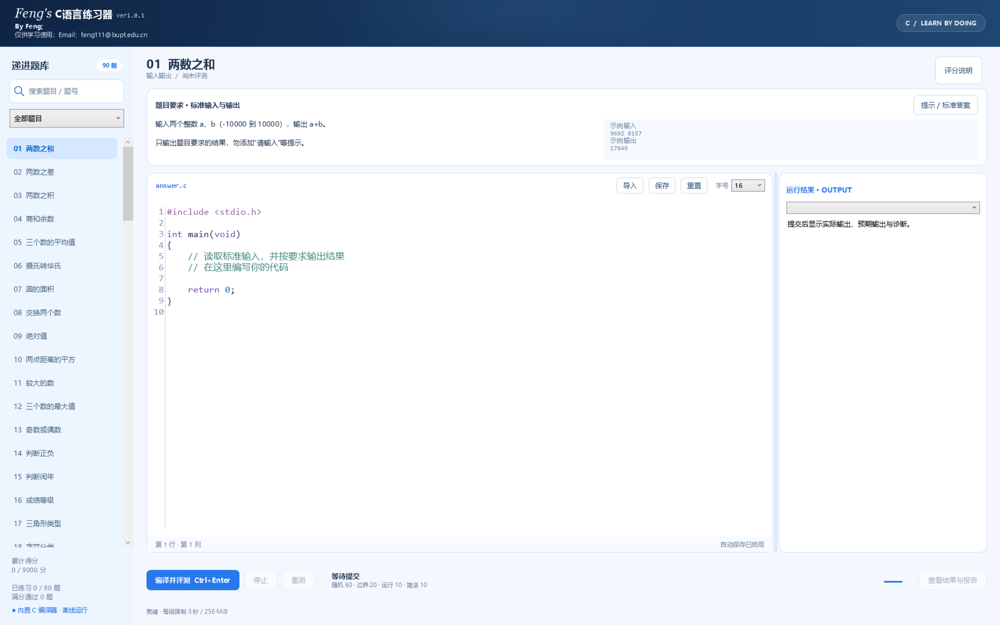

# Feng's C语言练习器

**ver1.0.1 · Windows 本地 C 语言编程练习与自动评测工具**

> By Feng; 仅供学习使用；

从基础语法到数据结构、算法与综合项目，软件提供 90 道递进题、内置 C 编译器、随机测试、具体运行反馈和标准答案。下载 EXE 后即可离线练习。



## 下载与运行

- [下载 ver1.0.1 EXE](releases/ver1.0.1/Feng_C语言练习器_ver1.0.1.exe?raw=true)
- [下载完整发布包](releases/ver1.0.1/Feng_C语言练习器_ver1.0.1_完整发布包.zip?raw=true)
- [使用说明](docs/使用说明.md) · [更新日志](CHANGELOG.md) · [验证报告](docs/验证报告.txt)

适用于 **x64 Windows，需 .NET Framework 4.8 或更新版本**。TinyCC 编译器与 AvalonEdit 编辑器均嵌入 EXE，无须另行安装 C 编译器。首次评测会释放编译器文件，之后完全离线运行。

## 功能

- **递进题库**：60 道基础题，27 道进阶题，最后 3 道综合项目考试：学生成绩管理、仓储订单系统与图书借阅系统。
- **代码编辑**：C 关键字、注释、字符串、数字和预处理指令着色；行号、14–24 字号、缩进、撤销和重做。
- **自动判题**：每题 8 组边界测试、20 组随机测试，支持相同种子重测和停止执行。
- **具体反馈**：主页面右侧显示输入、实际输出、预期输出、耗时、退出码及错误诊断；完整报告可导出。
- **提示与答案**：先显示解题提示，再展开标准答案；一键导入编码区，导入前自动备份原草稿。
- **学习记录**：自动保存草稿、记录各题最高分，显示累计得分 / 9000；高分时播放 1 秒庆祝动画。
- **高分屏界面**：深蓝渐变顶部，蓝色主界面，可拖动调整结果区宽度，支持高 DPI 显示。

## 学习路线

| 题号 | 内容 |
| --- | --- |
| 01–60 | 输入输出、条件判断、循环、数论、基础数组、字符串和矩阵 |
| 61–64 | 函数、指针与递归 |
| 65–75 | 二分查找、数组合并与去重、子段和、滑动窗口、前缀和、矩阵运算 |
| 76–80 | 子串、字符压缩、括号匹配、大整数、结构体排序 |
| 81–83 | 链表、栈与队列 |
| 84–87 | 动态规划、最长递增子序列与迷宫广度优先搜索 |
| 88–90 | 综合项目考试 |

## 评分

每题满分 100：随机正确性 60、边界正确性 20、运行质量 10、简洁度 10。简洁度根据有效行数和代码大小与参考答案比较，各占 5 分，保留合理余量；注释和空白不计大小，错误答案不会因简短得到分数。详细计算规则见 [更新日志](CHANGELOG.md#评分细则)。

整数精确比较，浮点允许绝对误差 0.0001。每组执行限制 3 秒、256 MiB，标准输出与标准错误合计约 64 KiB。运行本地 C 代码使用当前用户权限，资源限制不构成完整安全隔离。

## 从源码构建

在 Windows PowerShell 中执行：

```powershell
./source/build.ps1
```

需要 x64 Windows 与 .NET Framework 4.8。脚本使用系统 Framework C# 编译器，生成仓库根目录下的 `Feng_C语言练习器_ver1.0.1.exe`。仓库已附带构建所需的 TinyCC ZIP、AvalonEdit DLL 和图标资源。

| 文件 | 用途 |
| --- | --- |
| `source/AppWpf.cs` | 主界面、选题、草稿和评测交互 |
| `source/CodeEditor.cs` | 统一编辑布局和 C 语法着色 |
| `source/BankData.cs`、`AdvancedData.cs` | 90 道题目、提示与标准答案 |
| `source/Bank.cs`、`AdvancedTests.cs` | 随机、边界及项目状态测试 |
| `source/Engine.cs`、`CodeMetrics.cs` | 编译运行、判题与评分 |
| `source/AnswerWindow.cs` | 提示、答案查看和导入 |
| `source/Views.cs`、`BrandingWpf.cs` | 结果报告、动画、品牌与欢迎页 |

## 验证与记录

功能基线通过 90 道标准答案 × 2 组种子 × 28 用例，共 **5040 组测试**。编辑验证覆盖 6 种字号、3 种布局缩放、1134 个字符位置命中、18 次实际鼠标点击与 18 次跨行拖选，以及撤销、滚动、中文和换行。顶部深蓝配色随后重新编译并完成 2.5K 显示检查。

开发验证入口：

```powershell
./Feng_C语言练习器_ver1.0.1.exe --selftest ./verification.txt
./Feng_C语言练习器_ver1.0.1.exe --ui-test ./ui-verification.txt
```

`--ui-test` 会短暂操作测试窗口和鼠标，结束后恢复鼠标位置。测试数据与正常使用记录分开。以上验证不覆盖所有硬件、显示器组合或任意用户代码。

正常使用的数据目录为 `%LOCALAPPDATA%\CPracticeLab-ver1.0.1`，包含草稿、最高分和答案导入前的备份。仓库不包含个人练习记录。

## 作者与第三方组件

By Feng; 仅供学习使用；

项目自身未指定额外的开源授权许可。第三方组件各自的版权和许可证继续适用：

- AvalonEdit 6.3.1.120：MIT，见 [许可证](source/AvalonEdit-LICENSE.txt)。
- TinyCC 0.9.27：LGPL 2.1，见 [许可证](source/TinyCC-LGPL-2.1.txt)；[对应完整源码](source/tcc-0.9.27.tar.bz2) 一并提供。
- 详细来源见 [第三方组件说明](source/THIRD_PARTY.md)。
